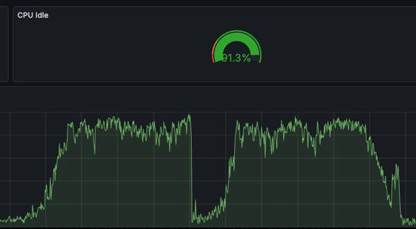
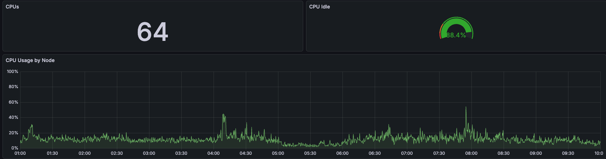

# Internals and performance

> Russian version: [internals.md](../ru/internals.md). The overview is in [README_EN.md](../../README_EN.md).

## Internals

In standard mode, `fasttruncate()` removes the files of a local temporary table
and creates empty replacements. Local buffers belong only to the current
backend, so other processes do not need to be notified about changes to those
files. Indexes, TOAST, and their metadata are rebuilt in the same backend.

`fasttrun_analyze()` keeps table-size estimates and column statistics in backend
memory. Planner hooks substitute those values for stale catalog values. A global
`ResetPlanCache` is not used during normal work. When necessary, plans are
marked stale only in the current backend through `PlanCacheRelCallback`.
Statistics hooks are installed lazily when the local cache is first created, so
the position of fasttrun in `shared_preload_libraries` does not determine their
order.

At backend exit, PostgreSQL core removes the backend's temporary tables. Every
removed relation produces a relcache message, and every such message walks all
saved plans of the backend. Before that, fasttrun marks the saved plans invalid
with `ResetPlanCache`, so the walk checks only that flag on those plans. Core
does not reset plans of transaction-control statements. Exit callbacks run in
reverse order of registration, and core registers its cleanup when the
transaction that created the temporary namespace commits. So at commit fasttrun
only notes that the temporary namespace exists, and registers its callback in
the first statement after that which goes through the executor hook or the
utility hook. That callback runs before the cleanup. There is no reset if the
temporary namespace is first created in the last transaction of the session,
if no such statement runs between that commit and the exit (for example, only
fastpath calls), or if the library is loaded later and has not seen a commit
yet. The exit then proceeds as without fasttrun.

fasttrun keeps its own journal of touched relations in backend memory,
organized by subtransaction level. The journal also records the level at which
a temporary relation was created. When that level is rolled back, the entries
of the vanishing table and its indexes are freed. Empty files of a table that
PostgreSQL core has not removed yet do not keep its cache in memory. When a
level ends, only the relations marked in that level are walked.

The journal also records the level at which `fasttruncate()` reset the files.
Rolling back such a level does not restore the statistics saved before the
reset: the old rows are gone, and the rows written after the reset are rolled
back with the level. The table is treated as empty, the pages of the rolled-back
refill stay in the page count because a scan reads them, and the column
statistics stay hidden until the next `fasttrun_analyze()`.

Rolling back a level that wrote the table restores the saved state, while the
pages of the rolled-back write stay in the file. The first write of a level
marks the table size and the accumulated dead-page count before it. The size
comes from the read the planner made for the same statement when no other
statement has started since and no statement already running was writing the
table at the time of the read, and is read anew otherwise. The
rollback takes the size from storage at the smgr level, without catalog access,
and recomputes the dead-page count from that mark: only its own level's growth
gets in, and nested rollbacks of one growth do not add up. The published page
count is scaled so that the planner counts live pages only, the size backstop of
the column statistics leaves them out too, and an analyze with dead pages since
the publication measures the size anew and refreshes the indexes. Dead pages by
themselves do not change the estimate, and the rollback does not reset cached
plans for them. It resets them when the forward path reset them or when a plan
was built on statistics the rolled-back DML hid.

The planner expands the body of an inlined SQL function inside
`standard_planner`, after the parse tree walk. The `get_relation_info` hook
brings the relstats back for relations from such bodies too and redoes the size
estimate the core has already made from the `pg_class` values, and the estimate
of a partial index whose rd_rel an invalidation of the index alone rebuilt.

In standard mode, the main functions do not modify `pg_class`, `pg_statistic`,
or the target table's relfilenode. Two paths are outside this contract:
prewarming uses regular DDL, and `fasttrun_analyze()` hands a table with
`CREATE STATISTICS` objects to regular `ANALYZE`, which writes the catalog.

## Performance

Results depend on table size, number of columns and indexes, storage speed,
PostgreSQL settings, and plan-cache size.

The main expected effects are:

- `fasttruncate()` avoids shared file-change messages in standard mode
- `fasttrun_analyze()` does not write `pg_class` or `pg_statistic`, except
  for a table with `CREATE STATISTICS` objects
- repeated analyze calls, in later transactions too, do not scan the table
  while the delta state is kept (the cases of a new pass are in
  [statistics](statistics.md)), and a statistics rebuild takes a block sample
  and deforms the sampled rows once per group of columns instead of once per
  column
- `invalidate_threshold` reduces unnecessary walks over the local plan cache
- queries without temporary tables keep the same plans and results
- at backend exit, the removal of temporary tables by PostgreSQL core walks the
  plan cache faster

The `check-no-temp-impact` test compares plans, results, replanning, and memory
for queries that do not use temporary tables. Once local caches are active,
entering the planner hook has a small but nonzero cost. In one measured scenario
it was about 0.26 microseconds per planning operation. This is a result from one
specific test, not a universal guarantee.

The plan reset at backend exit was measured on a release build of PostgreSQL 16
(Apple M2 Max). The exit of a backend with 2000 temporary tables and 20,000 saved
plans took 11.4 s instead of 20.1 s when the plans have a generic plan, and
15.5 s instead of 17.4 s without one. The absolute saving grows with the number
of temporary tables and saved plans.

A statistics rebuild after a refill (Apple M2 Max, PostgreSQL 16) takes 47 ms
instead of 267 ms on 100,000 rows of 300 columns with a leading text column,
19 ms instead of 29 ms on 300,000 rows of 30 columns, and 39 ms instead of
94 ms on 300,000 rows of 100 columns. The gain comes from deforming the sampled
rows once per group of columns instead of once per column and from block
sampling instead of a full scan. A group is bounded by a 16 MB array of sample
values, and the tables above fit in one. Narrow tables below 3,000 pages see
no difference.

The own work of `fasttruncate()` takes milliseconds, but on ext4 with
`data=ordered` removing the file of a large, freshly filled table can wait for
the kernel to write its dirty pages: on Linux, removing 512 MB took 175-205 ms,
almost all of it inside `unlink()`. The pages reach the OS cache when the table
does not fit in `temp_buffers` and is evicted from local buffers. If slow
`fasttruncate()` of large tables is noticeable, `temp_tablespaces` on a file
system without that mode (for example, XFS) helps, or a `temp_buffers` large
enough for the table's working set. The latter costs memory in every backend.

Clear marks for `fasttrun_temp_is_ours()` make the fast path of
`fasttruncate()` slightly more expensive. Measured on Tantor SE 18.6.3 (release
build, x86_64, 2 vCPU, `enable_temp_memory_catalog = off`): builds without
clear marks (2.6.0) and with them (2.7.0), six alternating series, backend
CPU time from `/proc/self/schedstat`, a temporary table of 4 columns with one
index.

| scenario | 2.6.0 | 2.7.0 |
|---|---:|---:|
| repeated clear of an empty table, `COMMIT` after each call | 4.64 us | 5.69 us |
| repeated clear of an empty table, further calls in the same transaction | 2.67 us | 3.00 us |
| repeated clear of 10 empty tables, `COMMIT` after each ten | 35.3 us | 41.6 us |
| empty `EXCEPTION` block in PL/pgSQL | 0.93 us | 1.07 us |

The first `fasttruncate()` call in a transaction creates two hash tables of
marks: about 1 us and 16 kB of memory per transaction. The memory goes away
with the transaction and does not grow with the number of subtransactions,
checked up to 80,000 rollbacks in one transaction. Further calls look the mark
up in the hash, about 0.3 us. The difference on an empty `EXCEPTION` block held
in every series, although the subtransaction callback returns at once there.
Its cost could not be told apart from a difference in code layout without
instruction counters. A full clear of a filled table, core `TRUNCATE` of a
temporary and a permanent table and an empty `COMMIT` showed no difference.
`fasttrun_temp_is_ours()` itself costs about 0.2 us per call,
`fasttrun_temp_same_cols()` about 0.45 us.

Clear marks write no catalog rows and send no invalidations. Both
functions open tables with `AccessShareLock`, like a plain read. When the
backend has no reference to the table's statistics entry yet (for example, an
empty table that was only cleared), `fasttrun_temp_is_ours()` looks the entry up
in the shared statistics hash table under a shared lock of one of its
partitions.

The synthetic test is in
[sql/fasttrun_bench.sql](../../sql/fasttrun_bench.sql). Use real plans and load tests
for your own system.

To compare two builds against each other there is
[scripts/bench_percolumn.sh](../../scripts/bench_percolumn.sh): it swaps in two
pre-built libraries in turn and runs
[scripts/bench_percolumn.sql](../../scripts/bench_percolumn.sql) in alternating
series, collecting the measurements into `scripts/raw.csv`. The alternation
matters: on single runs machine noise easily passes for a difference between
builds that is not there.

Example of the observed effect on one production cluster:





These graphs show one specific case and do not guarantee the same result on
another system.

## File layout

```
fasttrun.c                    # entry point: includes the src/ slices in build order
src/                          # C code: NN_name.c slices, one translation unit
fasttrun.control              # extension metadata
extension/                    # installation and upgrade SQL files
Makefile                      # PGXS build
examples/                     # integration examples
scripts/                      # checks and pre-release runner
sql/                          # 20 pg_regress suites
expected/                     # expected pg_regress output
```
