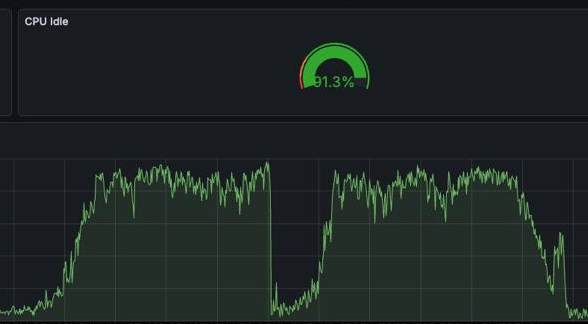
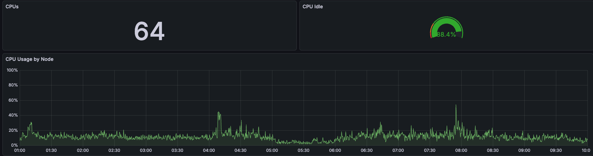

# Устройство и производительность

> English version: [internals.md](../en/internals.md). Обзор расширения - в [README](../../README.md).

## Внутреннее устройство

В стандартном режиме `fasttruncate()` удаляет файлы локальной временной
таблицы и создает пустые заново. Локальные буферы принадлежат только текущему
backend, поэтому другим процессам не нужно сообщать об изменении этих файлов.
Индексы, TOAST и их метаданные перестраиваются в том же backend.

`fasttrun_analyze()` хранит оценки размера и статистику столбцов в памяти
backend. Хуки планировщика подставляют эти значения вместо старых каталожных
значений. Во время работы общий `ResetPlanCache` не используется. При
необходимости планы помечаются устаревшими только в текущем backend через
`PlanCacheRelCallback`. Хуки статистики устанавливаются лениво при первом
создании локального кеша, поэтому их порядок не определяется положением
fasttrun в `shared_preload_libraries`.

При завершении backend ядро удаляет его временные таблицы. Каждое удаленное
отношение порождает сообщение relcache, и каждое такое сообщение обходит все
сохраненные планы backend. Перед этим fasttrun помечает сохраненные планы
невалидными через `ResetPlanCache`, и обход проверяет у таких планов только этот
флаг. Планы команд управления транзакциями ядро не сбрасывает. Колбэки выхода
выполняются в обратном порядке регистрации, а ядро регистрирует свою очистку
при фиксации транзакции, создавшей временную схему. Поэтому fasttrun при
фиксации только отмечает, что временная схема уже есть, а свой колбэк
регистрирует в первом после этого операторе, который проходит через хук
исполнителя или хук служебных команд. Такой колбэк выполняется раньше очистки.
Сброса нет, если временная схема впервые создана в последней транзакции
сеанса, если после такой фиксации до выхода не было подходящего оператора
(например, были только вызовы fastpath) или если библиотека загрузилась позже и
еще не видела фиксации. Тогда выход идет как без fasttrun.

fasttrun ведет в памяти backend собственный журнал затронутых отношений по
уровням подтранзакций. Журнал учитывает и уровень, на котором создано
временное отношение. При откате этого уровня записи исчезающей таблицы и ее
индексов освобождаются. Пустые файлы еще не удаленной ядром таблицы не
удерживают ее кеш в памяти. При завершении уровня обходятся только отношения,
отмеченные в нем.

Журнал отмечает и уровень, на котором `fasttruncate()` очистил файлы. Откат
такого уровня не восстанавливает статистику, сохраненную до очистки: прежних
строк уже нет, а записанные после очистки откатываются вместе с уровнем. Таблица
считается пустой, страницы откатившегося заполнения остаются в числе страниц,
потому что скан их читает, а статистика колонок скрывается до следующего
`fasttrun_analyze()`.

Откат уровня, на котором писали в таблицу, возвращает сохраненное состояние, а
страницы откатившейся записи остаются в файле. Первая запись уровня отмечает
размер таблицы и накопленное число мертвых страниц до нее. Размер берется из
чтения, которое сделал планировщик этого же оператора, если после чтения не
стартовал другой оператор, а в момент чтения таблицу не писал уже начатый
оператор, и иначе читается заново. Откат берет размер
из хранилища на уровне smgr, без обращения к каталогу, и пересчитывает число
мертвых страниц от этой отметки: так в него попадает только рост своего
уровня, а вложенные откаты одного роста не складываются. Опубликованное число
страниц масштабируется так, чтобы планировщик считал только живые страницы,
запасной сигнал по размеру у статистики колонок их тоже не считает, а analyze с
мертвыми страницами после публикации измеряет размер заново и обновляет
индексы. Сами мертвые страницы оценку не меняют, и из-за них откат планы не
сбрасывает. Он сбрасывает их, когда их сбрасывал прямой путь или когда план
построен на статистике, которую скрыл откаченный DML.

Планировщик раскрывает тело встроенной SQL-функции уже внутри
`standard_planner`, после обхода дерева разбора. Хук `get_relation_info`
возвращает relstats и отношениям из таких тел и пересчитывает оценку размера,
которую ядро успело сделать по значениям `pg_class`, а также оценку частичного
индекса, чей rd_rel пересобрала инвалидация одного индекса.

Основные функции в стандартном режиме не изменяют `pg_class`,
`pg_statistic` и relfilenode целевой таблицы. Вне этого контракта два пути:
предварительное создание таблиц - обычный DDL, а таблицу с объектами
`CREATE STATISTICS` `fasttrun_analyze()` передает обычному `ANALYZE`, который
пишет каталог.

## Производительность

Результат зависит от размера таблиц, числа столбцов и индексов, скорости
хранилища, настроек PostgreSQL и размера кеша планов.

Основные ожидаемые эффекты:

- `fasttruncate()` избегает общих сообщений об изменении файлов в стандартном
  режиме
- `fasttrun_analyze()` не пишет `pg_class` и `pg_statistic`, кроме таблицы с
  объектами `CREATE STATISTICS`
- повторный analyze, в том числе в следующих транзакциях, не сканирует таблицу,
  пока сохранено дельта-состояние (случаи нового прохода - в
  [статистике](statistics.md)), а пересбор статистики берет выборку блоков и
  разбирает строки выборки один раз на группу колонок, а не для каждой колонки
- `invalidate_threshold` сокращает лишние обходы локального кеша планов
- запросы без временных таблиц не меняют планы и результаты
- при завершении backend удаление временных таблиц ядром быстрее проходит по
  кешу планов

Проверка `check-no-temp-impact` сравнивает планы, результаты, повторное
планирование и память для запросов без временных таблиц. После активации
локальных кешей вход в хук планировщика имеет небольшую, но не нулевую стоимость.
В измеренном сценарии она составляла около 0,26 мкс на планирование. Это
результат конкретного теста, а не универсальная гарантия.

Сброс планов при завершении backend измерялся на релизной сборке PostgreSQL 16
(Apple M2 Max). Выход backend с 2000 временных таблиц и 20 000 сохраненных
планов занял 11,4 с вместо 20,1 с, если у планов есть generic plan, и 15,5 с
вместо 17,4 с без него. Абсолютная экономия растет с числом временных таблиц и
сохраненных планов.

Пересбор статистики после заполнения (Apple M2 Max, PostgreSQL 16) занимает
47 мс вместо 267 мс на 100 000 строк из 300 колонок с текстовой колонкой в
начале, 19 мс вместо 29 мс на 300 000 строк из 30 колонок и 39 мс вместо 94 мс
на 300 000 строк из 100 колонок. Выигрыш дают разбор строк выборки один раз на
группу колонок, а не для каждой колонки, и выборка блоков вместо полного
прохода. Группа ограничена массивом значений выборки в 16 МБ, на таблицах из
примеров она одна. На узких таблицах меньше 3000 страниц разницы нет.

Собственная работа `fasttruncate()` занимает миллисекунды, но на ext4 в режиме
`data=ordered` удаление файла большой только что заполненной таблицы может
ждать, пока ядро запишет ее грязные страницы: на Linux удаление 512 МБ заняло
175-205 мс, почти все время внутри `unlink()`. Страницы попадают в кеш ОС,
когда таблица не помещается в `temp_buffers` и вытесняется из локальных
буферов. Если долгий `fasttruncate()` больших таблиц заметен, поможет
`temp_tablespaces` на файловой системе без такого режима (например, XFS) или
`temp_buffers`, вмещающий рабочий объем таблицы. Последнее стоит памяти в
каждом backend.

Метки очистки для `fasttrun_temp_is_ours()` немного удорожают быстрый путь
`fasttruncate()`. Замер на Tantor SE 18.6.3 (релизная сборка, x86_64, 2 vCPU,
`enable_temp_memory_catalog = off`): сборки без меток очистки (2.6.0) и с ними
(2.7.0), шесть чередующихся серий, процессорное время backend по
`/proc/self/schedstat`, временная таблица из 4 колонок с одним индексом.

| сценарий | 2.6.0 | 2.7.0 |
|---|---:|---:|
| повторная очистка пустой таблицы, `COMMIT` после каждого вызова | 4,64 мкс | 5,69 мкс |
| повторная очистка пустой таблицы, следующие вызовы в той же транзакции | 2,67 мкс | 3,00 мкс |
| повторная очистка 10 пустых таблиц, `COMMIT` после каждой десятки | 35,3 мкс | 41,6 мкс |
| пустой блок `EXCEPTION` в PL/pgSQL | 0,93 мкс | 1,07 мкс |

Первый вызов `fasttruncate()` в транзакции создает две хеш-таблицы меток: около
1 мкс и 16 КБ памяти на транзакцию. Память освобождается вместе с транзакцией и
не растет с числом подтранзакций, проверено до 80 000 откатов в одной
транзакции. Следующие вызовы ищут метку в хеше, это около 0,3 мкс. Разница на
пустом блоке `EXCEPTION` держалась во всех сериях, хотя колбэк подтранзакции в
нем сразу возвращает управление. Отделить его цену от разницы в раскладке кода
без счетчиков инструкций не удалось. Полная очистка заполненной таблицы,
`TRUNCATE` ядра временной и постоянной таблицы и пустой `COMMIT` разницы не
показали. Сама `fasttrun_temp_is_ours()` стоит около 0,2 мкс на вызов,
`fasttrun_temp_same_cols()` около 0,45 мкс.

Метки очистки не пишут каталог и не рассылают инвалидаций. Обе функции
открывают таблицы с `AccessShareLock`, как обычное чтение. Если у backend еще
нет ссылки на запись статистики таблицы (например, у пустой таблицы, которую
только очищали), `fasttrun_temp_is_ours()` ищет эту запись в общей хеш-таблице
статистики под разделяемой блокировкой одного из ее разделов.

Синтетический тест находится в [sql/fasttrun_bench.sql](../../sql/fasttrun_bench.sql).
Для своей системы используйте реальные планы и нагрузочные тесты.

Для сравнения двух сборок между собой есть
[scripts/bench_percolumn.sh](../../scripts/bench_percolumn.sh): он по очереди
подкладывает две заранее собранные библиотеки и гоняет
[scripts/bench_percolumn.sql](../../scripts/bench_percolumn.sql) чередующимися
сериями, складывая замеры в `scripts/raw.csv`. Чередование здесь несущее:
на одиночных прогонах разброс машины легко выдает за разницу между сборками то,
чего нет.

Пример наблюдаемого эффекта на одном из рабочих кластеров:





Графики показывают конкретный случай и не являются гарантией такого же
результата на другой системе.

## Файловая структура

```
fasttrun.c                    # точка входа: подключает срезы src/ в порядке сборки
src/                          # C-код: срезы NN_имя.c, одна единица трансляции
fasttrun.control              # метаданные расширения
extension/                    # SQL-файлы установки и обновления
Makefile                      # сборка через PGXS
examples/                     # примеры интеграции
scripts/                      # проверки и pre-release runner
sql/                          # 20 наборов pg_regress
expected/                     # ожидаемый вывод pg_regress
```
